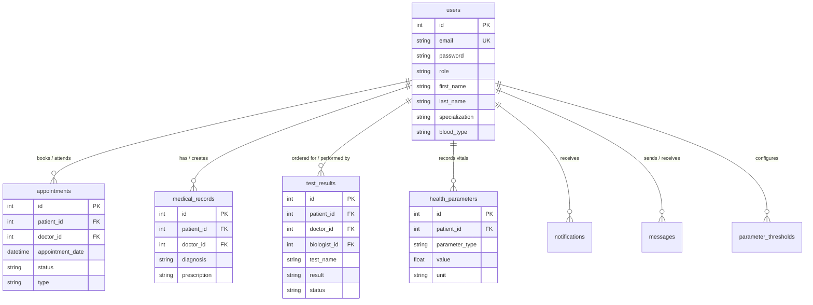

# NeoClinic Backend API

[](https://nodejs.org/)
[](https://expressjs.com/)
[](https://www.sqlite.org/)
[](LICENSE)

A robust, enterprise-ready RESTful backend API for healthcare and clinical practice management. Built with **Node.js**, **Express**, and **SQLite**, NeoClinic provides comprehensive role-based access control, appointment scheduling, medical records management, laboratory test workflows, biometric vitals tracking, real-time alerting, and internal messaging.

---

## Table of Contents

- [Features](#features)
- [Architecture & Tech Stack](#architecture--tech-stack)
- [Directory Structure](#directory-structure)
- [Getting Started](#getting-started)
  - [Prerequisites](#prerequisites)
  - [Installation](#installation)
  - [Environment Configuration](#environment-configuration)
  - [Database Setup & Seeding](#database-setup--seeding)
  - [Running the Application](#running-the-application)
- [Authentication & Role-Based Access Control](#authentication--role-based-access-control)
  - [User Roles & Permissions](#user-roles--permissions)
  - [Pre-Seeded Test Credentials](#pre-seeded-test-credentials)
- [Database Schema](#database-schema)
- [API Reference](#api-reference)
  - [Authentication (`/api/auth`)](#authentication-apiauth)
  - [Users Management (`/api/users`)](#users-management-apiusers)
  - [Appointments (`/api/appointments`)](#appointments-apiappointments)
  - [Medical Records (`/api/medical-records`)](#medical-records-apimedical-records)
  - [Test & Lab Results (`/api/test-results`)](#test--lab-results-apitest-results)
  - [Health Parameters & Vitals (`/api/health-parameters`)](#health-parameters--vitals-apihealth-parameters)
  - [Notifications & Alerts (`/api/notifications`)](#notifications--alerts-apinotifications)
  - [Messages (`/api/messages`)](#messages-apimessages)
- [Standard Error & Success Formats](#standard-error--success-formats)
- [Security Features](#security-features)

---

## Features

- **RBAC Authentication**: Secure JWT-based authentication with fine-grained permissions for Admins, Doctors, Biologists, and Patients.
- **Electronic Health Records (EHR)**: Centralized management of diagnoses, clinical notes, and prescriptions.
- **Laboratory Workflow**: Doctor-ordered lab tests, biologist result submission, reference-range validation, and automated patient notifications.
- **Health Vitals & Biometrics Monitoring**: Tracking vital parameters (Blood Pressure, Heart Rate, Glucose, etc.), statistical aggregation, trend tracking, and threshold alert triggers.
- **Appointment Scheduling**: Real-time conflict checking, status tracking (`scheduled`, `completed`, `cancelled`), and type classification.
- **Direct Messaging**: In-platform communication between doctors, patients, and staff.
- **In-App Notifications**: Real-time event notifications for test results, appointment updates, and threshold alerts.

---

## Architecture & Tech Stack

- **Runtime**: [Node.js](https://nodejs.org/) (v14 or higher)
- **Web Framework**: [Express.js](https://expressjs.com/)
- **Database Engine**: [SQLite3](https://www.sqlite.org/) (File-backed storage via `database.sqlite`)
- **Security & Headers**: [Helmet](https://helmetjs.github.io/), [CORS](https://github.com/expressjs/cors), [bcryptjs](https://github.com/dcodeIO/bcrypt.js)
- **Validation**: [express-validator](https://express-validator.github.io/)
- **Logging**: [Morgan](https://github.com/expressjs/morgan) (HTTP request logger)

---

## Directory Structure

```text
neoclinic_backend/
├── src/
│   ├── config/
│   │   ├── database.js          # Database connection provider
│   │   ├── migrations.js        # Table schemas & index definitions
│   │   └── seed.js              # Initial database seed dataset
│   ├── middleware/
│   │   └── auth.js              # JWT verification & checkRole middlewares
│   ├── routes/
│   │   ├── appointments.js      # Appointment scheduling endpoints
│   │   ├── auth.js              # User authentication (register/login)
│   │   ├── health-parameters.js # Vitals, trends, stats & alert thresholds
│   │   ├── medical-records.js   # Clinical diagnoses & prescription records
│   │   ├── messages.js          # Direct communication between users
│   │   ├── notifications.js     # User alert and notification feeds
│   │   ├── test-results.js      # Lab orders and result publishing
│   │   └── users.js             # User profiles & administrative CRUD
│   ├── scripts/
│   │   └── reseed.js            # Automated database wipe & reseed utility
│   └── index.js                 # Express application root & middleware setup
├── database.sqlite              # Active SQLite database file
├── package.json                 # Project dependencies & scripts
└── README.md                    # Backend documentation
```

---

## Getting Started

### Prerequisites

- **Node.js** `>= 14.x` (LTS recommended)
- **npm** `>= 6.x` or **yarn**

### Installation

Clone the repository and install all dependencies:

```bash
git clone https://github.com/your-org/neoclinic_backend.git
cd neoclinic_backend
npm install
```

### Environment Configuration

Create a `.env` file in the project root:

```env
PORT=8000
NODE_ENV=development
JWT_SECRET=super-secret-jwt-key-replace-in-production
```

### Database Setup & Seeding

The database will automatically initialize tables on first launch. If you wish to populate default mock data (doctors, patients, appointments, lab tests, etc.):

```bash
# Populate initial seed data
node src/config/seed.js

# Or reset and reseed from scratch:
node src/scripts/reseed.js
```

### Running with Docker (Recommended)

To run the backend with Docker without needing local Node.js or npm installed:

```bash
# Build and run container in detached mode
docker compose up -d --build

# View real-time logs
docker compose logs -f

# Stop container
docker compose down
```

The database (`database.sqlite`) is mounted as a volume so data persists across rebuilds.

### Running Locally (Without Docker)

```bash
# Start in development mode (with nodemon live reload)
npm run dev

# Start in production mode
npm start

# Run unit / integration test suite
npm test
```

The server will be available at `http://localhost:8000`.
- **Interactive Swagger Documentation**: [http://localhost:8000/api-docs](http://localhost:8000/api-docs)
- **OpenAPI 3.0 Spec JSON**: [http://localhost:8000/api-docs.json](http://localhost:8000/api-docs.json)

---

## Authentication & Role-Based Access Control

All protected endpoints require a valid JWT token in the `Authorization` header:

```http
Authorization: Bearer <your_jwt_token>
```

### User Roles & Permissions

| Role | Description | Core Capabilities |
| :--- | :--- | :--- |
| **`admin`** | System Administrator | Full access to user management, metrics, and global records. |
| **`doctor`** | Medical Practitioner | Manage appointments, write medical records, order lab tests, review vitals. |
| **`biologist`**| Clinical Lab Specialist | View ordered lab tests, input test results, evaluate normal/abnormal ranges. |
| **`patient`** | Registered Client | View personal appointments, vitals, medical records, test results, and message care team. |

### Pre-Seeded Test Credentials

The database comes pre-seeded with the following test accounts:

| Email | Password | Role | Description |
| :--- | :--- | :--- | :--- |
| `admin@healthcare.com` | `admin123` | `admin` | Full administrator account |
| `doctor1@healthcare.com` | `doctor123` | `doctor` | Dr. John Smith (Cardiologist) |
| `doctor2@healthcare.com` | `doctor123` | `doctor` | Dr. Sarah Johnson (Pediatrician) |
| `biologist1@healthcare.com` | `biologist123` | `biologist` | Michael Brown (Clinical Lab) |
| `patient1@healthcare.com` | `patient123` | `patient` | Alice Wilson (Blood: A+) |
| `patient2@healthcare.com` | `patient123` | `patient` | Robert Davis (Blood: O-) |

---

## Database Schema

The SQLite schema consists of 10 interconnected tables:



---

## API Reference

### Authentication (`/api/auth`)

| Method | Endpoint | Access | Description |
| :--- | :--- | :--- | :--- |
| `POST` | `/api/auth/register` | Public | Register new user (`patient`, `doctor`, `biologist`, `admin`). |
| `POST` | `/api/auth/login` | Public | Authenticate user and receive JWT bearer token. |

#### Example: Login Request
```bash
curl -X POST http://localhost:8000/api/auth/login \
  -H "Content-Type: application/json" \
  -d '{"email": "doctor1@healthcare.com", "password": "doctor123"}'
```

---

### Users Management (`/api/users`)

| Method | Endpoint | Access | Description |
| :--- | :--- | :--- | :--- |
| `GET` | `/api/users` | Admin only | Retrieve list of all registered users. |
| `GET` | `/api/users/:id` | Authenticated | Retrieve profile details of a specific user. |
| `PUT` | `/api/users/:id` | Owner / Admin | Update profile data (name, phone, blood type, allergies). |
| `DELETE`| `/api/users/:id` | Admin only | Permanently delete user record. |

---

### Appointments (`/api/appointments`)

| Method | Endpoint | Access | Description |
| :--- | :--- | :--- | :--- |
| `GET` | `/api/appointments` | Authenticated | Retrieve all appointments for the authenticated doctor or patient. |
| `POST` | `/api/appointments` | Patient | Book new appointment with conflict detection. |
| `PUT` | `/api/appointments/:id` | Doctor / Patient | Update status (`scheduled`, `completed`, `cancelled`) or notes. |
| `DELETE`| `/api/appointments/:id` | Doctor / Patient | Cancel an appointment. |

---

### Medical Records (`/api/medical-records`)

| Method | Endpoint | Access | Description |
| :--- | :--- | :--- | :--- |
| `GET` | `/api/medical-records` | Authenticated | List medical records relevant to the current user. |
| `GET` | `/api/medical-records/:id` | Authenticated | View details of a specific record. |
| `POST` | `/api/medical-records` | Doctor | Create a clinical entry (diagnosis, prescription, clinical notes). |
| `PUT` | `/api/medical-records/:id` | Attending Doctor | Update an existing medical record. |

---

### Test & Lab Results (`/api/test-results`)

| Method | Endpoint | Access | Description |
| :--- | :--- | :--- | :--- |
| `POST` | `/api/test-results/order` | Doctor | Order a laboratory test for a patient. |
| `PUT` | `/api/test-results/:id` | Biologist | Submit lab test findings, reference ranges, and notes. |
| `GET` | `/api/test-results` | Authenticated | Query lab tests (filterable by `patient_id` or `status`). |
| `GET` | `/api/test-results/:id` | Authenticated | Retrieve comprehensive test record and biologist notes. |

---

### Health Parameters & Vitals (`/api/health-parameters`)

Track physiological measurements (e.g., `blood_pressure_systolic`, `heart_rate`, `blood_glucose`).

| Method | Endpoint | Access | Description |
| :--- | :--- | :--- | :--- |
| `GET` | `/api/health-parameters` | Authenticated | Get vitals log (accepts `type`, `startDate`, `endDate`). |
| `POST` | `/api/health-parameters` | Doctor / Patient | Record a new vital sign measurement. |
| `GET` | `/api/health-parameters/stats` | Authenticated | Min, max, and average metric statistics. |
| `GET` | `/api/health-parameters/trends`| Authenticated | Historical chronological trend data points. |
| `GET` | `/api/health-parameters/alerts`| Authenticated | Parameters exceeding configured physiological thresholds. |
| `POST` | `/api/health-parameters/thresholds` | Authenticated | Define custom alarm thresholds (`min_value`, `max_value`). |

---

### Notifications & Alerts (`/api/notifications`)

| Method | Endpoint | Access | Description |
| :--- | :--- | :--- | :--- |
| `GET` | `/api/notifications` | Authenticated | List all user notifications (filterable by `read` state). |
| `POST` | `/api/notifications` | Admin / Doctor | Dispatch a notification to a specific user. |
| `PUT` | `/api/notifications/:id/read` | Recipient | Mark single notification as read. |
| `PUT` | `/api/notifications/read-all` | Recipient | Mark all notifications as read. |
| `GET` | `/api/notifications/unread-count` | Recipient | Retrieve total unread notifications count. |

---

### Messages (`/api/messages`)

| Method | Endpoint | Access | Description |
| :--- | :--- | :--- | :--- |
| `GET` | `/api/messages` | Authenticated | Retrieve conversation history (supports `with_user` filter). |
| `POST` | `/api/messages` | Authenticated | Send a direct message to another user. |
| `PUT` | `/api/messages/:id/read` | Recipient | Mark specific message as read. |
| `GET` | `/api/messages/unread` | Authenticated | Get count of unread incoming messages. |

---

## Standard Error & Success Formats

### Success Response
```json
{
  "status": "success",
  "data": { ... }
}
```

### Validation Error (`400 Bad Request`)
```json
{
  "errors": [
    {
      "type": "field",
      "value": "invalid-email",
      "msg": "Invalid value",
      "path": "email",
      "location": "body"
    }
  ]
}
```

### Unauthorized (`401 Unauthorized`)
```json
{
  "message": "Token verification failed, authorization denied"
}
```

---

## Security Features

- **Password Hashing**: `bcryptjs` with salt round cost factor 10.
- **HTTP Header Hardening**: Secured using `helmet` to mitigate common web attack vectors (XSS, clickjacking, MIME sniffing).
- **Parameterized SQL**: All SQLite queries utilize parameterized placeholders (`?`) to guarantee SQL injection prevention.
- **CORS Configured**: Cross-Origin Resource Sharing enabled for frontend client integration.
- **Foreign Key Constraints**: Foreign keys enforced via `PRAGMA foreign_keys = ON` with cascading deletions where appropriate.
